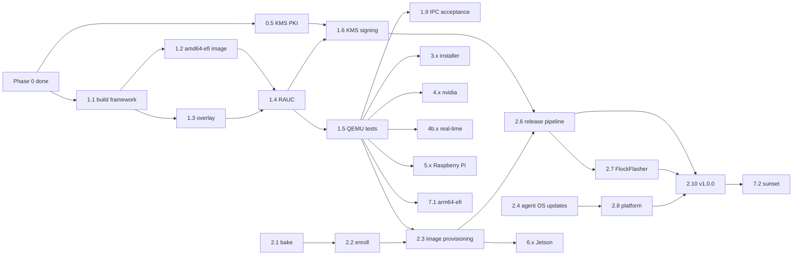

# FlockOS implementation plan

The [master plan](master-plan.md) says what FlockOS is and in which phases it is built.
This document cuts those phases into **work packages** (WPs): units of one to five days
that end in one pull request, one cross-repo change, or one hardware session, each with
a verifiable acceptance criterion. It is the list to work from; the master plan stays the
reference for *why*.

Status as of 2026-11-04. Phase 0 is complete (release v0.9.0 is tagged).

## How to use this plan

- **One GitHub issue per work package** in `IronFlock/flockos`, titled `WP-<id> <title>`,
  labelled `wp`, in the milestone of its phase. A WP in another repository gets its issue
  there and is linked from the flockos issue. Status lives in the issues; this document is
  updated at the end of each phase (status board, lessons, re-estimates).
- **Definition of done** for every WP: the pull request is merged with `ci-ok` and
  `security / report` green; the behaviour has a test where one is possible (bats for
  scripts, QEMU for images); documentation under `docs/` is updated; the acceptance
  evidence (log, screenshot, serial console capture for hardware steps) is attached to the
  issue.
- **Estimates** are working days for one engineer who knows the stack, ±50%. They add up
  to the master plan's engineer-weeks per phase. Phase 2 is spread over four repositories
  and two teams, so its calendar time depends on who is free, not on the sum.
- **Ordering.** Dependencies are listed per WP. Within a phase, WPs without a mutual
  dependency can run in parallel. Phases 3, 4 and 4b are independent of 5; Phase 6 needs
  only Phase 2.
- **Hardware gates.** CI has no GPU, no Raspberry Pi and no Jetson. Each target phase ends
  in a hardware acceptance WP with a written checklist (`docs/testing.md`). Nobody closes a
  target phase from QEMU alone.

## Milestones

| Milestone | Means | Phase | Reached |
|-----------|-------|-------|---------|
| M0 | Repo is the FlockOS home with the harness; `v0.9.0` tagged | 0 | 2026-11-04 |
| M1 | A CI-built `amd64-efi` image boots in QEMU on a pull request | 1 | |
| M2 | QEMU A/B update and fallback pass on every pull request; KMS-signed bundle from a workflow | 1 | |
| M3 | `v1.0.0`: flashed from FlockFlasher, online in IronFlock, updated from the platform with rollback verified | 2 | |
| M4 | Sealed IPC installed unattended from the installer USB | 3 | |
| M5 | `nvidia-smi` in a container on a FlockOS GPU host | 4 | |
| M6 | `-rt` image passes the one-hour latency acceptance on an IPC | 4b | |
| M7 | Pi 4 and Pi 5 enroll and update with rollback from a FlockFlasher image | 5 | |
| M8 | Orin Nano enrolls and runs a CUDA container; Orin NX updates with rollback | 6 | |
| M9 | `arm64-efi` boots in QEMU; ReswarmOS sunset date published; docs reviewed | 7 | |

## Status board

Repo: `flockos` unless stated. Status: done, open, blocked (waiting on another WP or a
decision), in progress.

| WP | Title | Repo | Days | Depends on | Status |
|----|-------|------|------|------------|--------|
| 0.1 | Repository home, rulesets, release environment | flockos, GitHub | 1 | | done |
| 0.2 | Secrets hygiene | flockos, legacy repo, GCS | 1 | | done (VM password rotation is an owner action) |
| 0.3 | Harness skeleton, docs, legacy tag, v0.9.0 | flockos | 2 | 0.1 | done |
| 0.4 | `shell-gate.yml` in the harness | workflows | 2 | | done (#158) |
| 0.5 | RAUC PKI in Cloud KMS and `docs/signing.md` | GCP, flockos | 2 | | done (ceremony 2026-11-05, #167) |
| 0.6 | Security scan switches from report-only to blocking | flockos | 0.5 | 0.3 | open (due 2026-11-18) |
| 1.1 | Build framework and `base` rootfs | flockos | 3 | 0.3 | done (#155) |
| 1.2 | `amd64-efi` target: GRUB, partitions, disk image | flockos | 3 | 1.1 | done (#155) |
| 1.3 | Shared overlay: `/data` redirections, os-release, enroll placeholder | flockos | 2 | 1.1 | done (#155) |
| 1.4 | RAUC integration and bundle build | flockos | 3 | 1.2, 1.3 | done (#155) |
| 1.5 | QEMU test harness and `image-test` job | flockos | 3 | 1.4 | done (#155) |
| 1.6 | Release signing through KMS/PKCS#11; `build` and `sign` jobs | flockos | 2 | 0.5, 1.4 | done (#168); the KMS signature is first used by the first release |
| 1.7 | fwupd in the image | flockos | 1 | 1.3 | done (#155) |
| 1.8 | Rootfs vulnerability scan and SBOM in `security.yml` | flockos, workflows | 1 | 1.1 | done (#169, the harness's rootfs-recipe input) |
| 1.9 | Hardware acceptance on an x86 IPC; target and testing docs | flockos, hardware | 2 | 1.5 | open: needs an x86 IPC |
| 2.0 | Decisions before Phase 2 (hostname, channels, first firmware lane) | all | 0.5 | | done (ADR-0009) |
| 2.1 | `ironflock-init bake` | device-init | 2 | 2.0 | done (device-init 1.4.9) |
| 2.2 | `ironflock-init enroll`, os-release detection, offline tolerance | device-init | 3 | 2.1 | done in device-init 1.4.9; open: the `flockos-amd64` target in device-init's e2e |
| 2.3 | Image provisioning: bake at build, enroll at first boot, agent preinstalled | flockos | 2 | 1.5, 2.1, 2.2 | done (#159) |
| 2.4 | OS update client in the device-agent | device-agent | 5 | 2.0 | done (device-agent #202 in 1.6.0, the catalog key in 1.6.1); the images' only health gate since flockos-mark-good went |
| 2.5 | Firmware RPCs in the device-agent (fwupd D-Bus) | device-agent | 3 | 1.7 | done in device-agent #201 (read-only, ADR-0009) |
| 2.6 | `release.yml`: stage, e2e, promote, signed manifest, GitHub Release | flockos, GCP | 4 | 1.6, 2.3 | done (#170; catalog key 2026-11-05, trusted by device-agent 1.6.1) |
| 2.7 | FlockFlasher: signed catalog, variants, `FLOCKOS` targeting | flasher | 4 | 2.6 (manifest shape agreed in 2.0) | blocked on 2.6 |
| 2.8 | Platform: OS version, slot status, OS update action | platform | 3 | 2.4 | blocked on 2.4 |
| 2.9 | Platform: firmware inventory and update actions | platform | 3 | 2.5 | blocked on 2.5 |
| 2.10 | Phase 2 acceptance: `v1.0.0` end to end | all | 2 | 2.6, 2.7, 2.8 | blocked on 2.6, 2.7, 2.8 |
| 3.1 | `flockos-installer` program | flockos | 4 | 1.5 | done (#156) |
| 3.2 | `installer` variant image with embedded payload; QEMU install test | flockos | 3 | 3.1 | done (#156) |
| 3.3 | Installer in FlockFlasher; hardware acceptance on a sealed IPC | flasher, hardware | 2 | 3.2, 2.7 | blocked on 2.7; needs a sealed IPC |
| 4.1 | `nvidia` profile: open kernel modules built in the chroot, container toolkit | flockos | 4 | 1.5 | done (#160) |
| 4.2 | GPU host acceptance, installer payload option, GPU docs | flockos, hardware | 2 | 4.1, 3.2 | open: needs a GPU host |
| 4b.1 | `kernel-rt` profile, `-rt` images, tuning unit | flockos | 3 | 1.5 | done (#157) |
| 4b.2 | RT acceptance on hardware; platform CPU-set setting; app template | flockos, platform, ironflock-templates, hardware | 3 | 4b.1 | open: needs RT hardware |
| 5.1 | `rpi-arm64` rootfs, kernels, boot partitions, disk image | flockos | 4 | 1.5 | done (#162) |
| 5.2 | tryboot A/B: RAUC `custom` backend, boot+rootfs slot groups, `cmdline.txt` hook | flockos | 5 | 5.1 | done (#163); on hardware in 5.4 |
| 5.3 | Pi EEPROM lane and boot configuration | flockos | 2 | 5.2 | open: needs a Pi 4 and a Pi 5 |
| 5.4 | Pi hardware acceptance; FlockFlasher entries; target docs | flockos, flasher, hardware | 4 | 5.2, 5.3 | open: needs a Pi 4 and a Pi 5 |
| 5.5 | Follow-up: Raspberry Pi RT kernel built in CI | flockos | 8 | 5.4, 4b.1 | open |
| 6.1 | BSP decision, download and cache | flockos | 2 | | done (#164, ADR-0008 accepted) |
| 6.2 | `jetson-orin` rootfs and layout | flockos | 6 | 6.1, 2.3 | done (#171, #173, #174, #177) |
| 6.3 | RAUC `custom` backend over `nvbootctrl`; health gate | flockos | 4 | 6.2 | open |
| 6.4 | Orin Nano SD image and NX/AGX flash package | flockos | 5 | 6.3 | open |
| 6.5 | Jetson QSPI capsule lane | flockos | 3 | 6.3 | open |
| 6.6 | Jetson hardware acceptance; FlockFlasher entries; target docs | flockos, flasher, hardware | 5 | 6.4, 6.5 | open |
| 6.7 | Follow-up: Jetson RT kernel | flockos | 5 | 6.6, 4b.1 | open |
| 7.1 | `arm64-efi` target and installer payload | flockos | 3 | 1.5 | done (#161; arm64-efi installer #172) |
| 7.2 | ReswarmOS migration guide and sunset | flockos, GCS, flasher, device-agent | 2 | 2.10 | open |
| 7.3 | Documentation refresh and review | flockos | 3 | 7.1, 7.2 | open |
| X.1 | Public install guides per target | website | 1 per target | 2.10, 5.4, 6.6 | open |

Totals in days: Phase 0 remaining 4.5; Phase 1 20; Phase 2 31.5 across four repositories;
Phase 3 9; Phase 4 6; Phase 4b 6; Phase 5 15 (+8 follow-up); Phase 6 25 (+5 follow-up);
Phase 7 8.

## Dependency graph

## Phase 0: Foundations and hygiene

Goal and acceptance: see master plan, Phase 0. Reached on 2026-11-04 with `v0.9.0`.
Three packages remain because they were scheduled into the first two weeks rather than
into the release pull request.

### WP-0.1 Repository home, rulesets, release environment (done)

`RecordEvolution/ReswarmOS` transferred to public `IronFlock/flockos`, default branch
`main`, rulesets "main: pull requests with green checks" and "release tags v*",
`release` environment with `RELEASE_APP_CLIENT_ID` and `RELEASE_APP_PRIVATE_KEY`, squash
merges with pull-request title and body. Lesson recorded: a transfer carries classic
branch protection along; it had to be removed so only the ruleset applies.

### WP-0.2 Secrets hygiene (done, one owner action open)

Legacy trees removed from `main`; `gs://reswarmos-certs` emptied; the committed RAUC key
deleted from the tip of the archived `flockos-buildroot-legacy` and noted in its README;
the leaked GitHub token from 2022 confirmed dead and its alert resolved; secret scanning
with push protection and validity checks enabled. Open: rotate the development VM password
that `cubic/README.md` exposed (owner action, outside the repository).

### WP-0.3 Harness skeleton, docs, legacy tag, v0.9.0 (done)

`Justfile` with `lint`, `test`, `build TARGET VARIANT` (placeholder), `merge`,
`release-*`; `ci.yml`, `security.yml` (report-only), `release.yml` (verify, tag);
`docs/` with the master plan, audit and ADRs 0001 to 0007; tag `legacy/reswarmos-0.5.7`;
release `v0.9.0`.

### WP-0.4 `shell-gate.yml` in the harness (2 days, `IronFlock/workflows`)

- Scope: a reusable gate for shell/`just` repositories, as `go-gate.yml` is for Go. Jobs
  `lint` (`shellcheck`, `shfmt -d`, `yamllint`, `just --fmt --check`), `unit` (`just test`,
  bats from `tools.lock`), `build` (`just build` with inputs for the recipe arguments).
  Tools come from `tools.lock` through `install-tool.sh`. A fixture repository under
  `tests/fixtures/shell-pass` and `shell-fail` in the harness self-test.
- Deliverables: the workflow, fixtures, README section, harness release (`v1` moved).
  Then `ci.yml` in flockos replaces its repository-local `gate` with the reusable one.
- Acceptance: the flockos `ci.yml` is a thin caller again (no tool installation of its
  own) and `ci-ok` stays green; the harness self-test covers a failing shell fixture.

### WP-0.5 RAUC PKI in Cloud KMS and `docs/signing.md` (2 days, GCP + flockos)

- Scope: per [ADR-0006](adr/0006-rauc-pki-in-cloud-kms.md) and its implementation
  note. HSM keys `flockos-rauc-ca/root` (disabled after use, 20-year CA certificate)
  and `flockos-rauc/bundle-signer` (3-year certificate), RSA 4096 PKCS#1 SHA-256, in
  two dedicated key rings in `europe-west1`, project `record-1283`; service account
  `flockos-release@record-1283` with `roles/cloudkms.signerVerifier` on the signer key
  and `roles/cloudkms.viewer` on its ring only; workload identity binding of pool
  `github-pool` for release runs of `IronFlock/flockos`. Certificates committed in
  `pki/`. Done by `tools/rauc-pki/ceremony.sh`, run by a project owner.
- Deliverables: the keys, the two certificates, `docs/signing.md` (the exact `libkmsp11`
  configuration, `RAUC_PKCS11_MODULE`, the `pkcs11:` URI, the rotation procedure for the
  signer, what a dry run uses instead), and a `workflow_dispatch` job that proves
  `rauc bundle --key 'pkcs11:...'` from a runner against a trivial bundle.
- Acceptance: `openssl verify` chains the signer certificate to the CA; the CA key
  version is disabled; no key material appears in the repository, in logs or in
  artefacts. The workload identity grants the signer only to release runs on `main` or
  a `v*` tag, so the PKCS#11 path is proven by the first release after WP-1.6, not by a
  manual run.

### WP-0.6 Security scan switches to blocking (half a day, due 2026-11-18)

- Scope: `security.yml` `fail-on` from `""` to the standard list used by device-init once
  the report has been clean for two weeks.
- Acceptance: a pull request that plants a secret in a fixture is blocked by
  `security / report`; the weekly run is green on `main`.

## Phase 1: `amd64-efi` base image with A/B

Goal and acceptance: see master plan, Phase 1 and sections 3.2, 3.3, 3.5, 3.8.
Milestones M1 (WP-1.2) and M2 (WP-1.5, WP-1.6).

### WP-1.1 Build framework and `base` rootfs (3 days)

- Scope: `build/lib.sh`, `build/mkrootfs.sh` (`mmdebstrap --mode=unshare
  --variant=minbase`, Debian 13, `SOURCE_DATE_EPOCH` from the commit), `profiles/base`
  (package list of section 3.7 for amd64, apt sources for Debian and
  `download.docker.com`, pinned Docker CE version, hooks directory), `tools.lock` with
  mmdebstrap, genimage, rauc, bats, shellcheck, shfmt, `just build TARGET VARIANT`
  running the rootfs stage, bats unit tests of `lib.sh` and the profile merge logic.
  Builds on `/mnt` on the runner; apt caches cleaned.
- Deliverables: a rootfs tar per target and variant, the `trivy rootfs` CycloneDX SBOM of
  it, unit tests, `docs/build.md` (how to run the build locally in a container for
  debugging, although CI is the build of record).
- Acceptance: `just build amd64-efi base` in CI produces the rootfs in under 10 minutes;
  timestamps, filesystem UUIDs and seeds are derived from the commit, and the package
  manifest (`packages.tsv`) lists Docker CE at the pinned versions and the kernel. Bit
  identity across days is not a goal while the Debian archive is not pinned to a
  snapshot (`docs/build.md`).

### WP-1.2 `amd64-efi` target: GRUB, partitions, disk image (3 days)

- Scope: `targets/amd64-efi/{target.conf,genimage.cfg,repart.d/,grub/}`;
  `build/mkimage.sh` (`mke2fs -d` for the slots, `mkfs.vfat` + `mcopy` for the ESP,
  `genimage`, sparse output, `gzip -k`); GRUB EFI binary with the RAUC A/B `grub.cfg`
  reading `ORDER`, `A_OK/A_TRY`, `B_OK/B_TRY` from `grubenv` on the ESP; kernel and
  initrd inside the slot; partition layout and labels of section 3.2 (`FLOCKOS`,
  `rootfs-a`, `rootfs-b`, `data`). The image holds `FLOCKOS` and `rootfs-a` only;
  `systemd-repart` creates `rootfs-b` and `data` on the first boot, which keeps the
  image at 4.3 GB instead of 8.3 GB.
- Deliverables: `flockos-amd64-efi-base-<v>.img.gz` from `just build amd64-efi base`,
  a `just qemu` recipe that boots the image with OVMF for manual inspection.
- Acceptance (M1): the CI-built image boots in QEMU/OVMF to `multi-user.target`; `lsblk`
  shows the four partitions with the expected labels; `data` has grown to the rest of a
  16 GiB virtual disk after the first boot; a second boot is clean.

### WP-1.3 Shared overlay: `/data` redirections, os-release, enroll placeholder (2 days)

- Scope: `overlay/` with the units and symlinks that implement the redirection table of
  section 3.2 as bind mounts (`/opt/ironflock`, `/home`, NetworkManager connections,
  journal, `/var/cache/flockos`, `/var/lib/fwupd`), SSH host keys on `/data`, and the
  machine-id and hostname carried into each new slot by a RAUC post-install handler
  (a machine-id on `/data` would be needed before `/data` is mounted),
  `/etc/os-release` written by the build from `VERSION`, target, variant and commit in the
  contract of section 3.1, `flockos-enroll.service` that for now runs the public
  device-init installer with the newest `*.flock` from `FLOCKOS` (full enroll is WP-2.3),
  no root password, no default user, `PermitRootLogin no`, unattended upgrades off, the
  telemetry-free motd.
- Deliverables: the overlay, bats tests for the redirection setup script, a QEMU check
  list used by WP-1.5.
- Acceptance: in QEMU, `machine-id` and SSH host keys survive a reboot and live on
  `/data`; `journalctl --list-boots` shows both boots; `/etc/os-release` has `ID=flockos`,
  `IMAGE_ID=flockos-amd64-efi-base`, `IMAGE_VERSION`, `BUILD_ID` and the legacy-shaped
  `VERSION`; `ssh` with a password is refused.

### WP-1.4 RAUC integration and bundle build (3 days)

- Scope: `targets/amd64-efi/rauc/system.conf` (`grub` bootloader backend,
  `compatible=flockos-amd64-efi-base`, `use-bundle-signing-time=true`, grubenv path on
  the ESP), `build/mkbundle.sh` generating `manifest.raucm` from `VERSION`, target and
  variant and building a `verity` bundle, a throwaway key pair generated per CI run for
  pull requests with its certificate embedded as the image keyring, the kernel command
  line carrying `rauc.slot=`, `rauc status mark-good` deliberately **not** run at boot
  (the agent does it in Phase 2; until then a `flockos-mark-good.service` placeholder
  marks good after Docker is up so Phase 1 testing works).
- Deliverables: `flockos-amd64-efi-base-<v>.raucb` from `just build`, `just bundle`,
  bats tests of the manifest generator.
- Acceptance: in QEMU, `rauc status` reports slot A booted and good; `rauc install` of
  the bundle from the same build writes slot B and sets it primary; after reboot slot B
  is booted; corrupting slot B's kernel and rebooting three times falls back to A.

### WP-1.5 QEMU test harness and `image-test` job (3 days)

- Scope: `test/qemu/run.py` (Python standard library, driving a root debug shell on
  the second serial port that the test copy's grubenv enables): boot to multi-user,
  redirection checks of WP-1.3, Docker
  runs a preloaded `hello-world` image, the A/B and fallback sequence of WP-1.4, fwupd
  inventory (WP-1.7); serial console capture as artefact on failure; KVM on the
  GitHub-hosted runner; `ci.yml` job `image-test` after `gate`, required by `ci-ok`.
- Deliverables: the test suite, the job, `docs/testing.md` (QEMU section).
- Acceptance (M2, first half): the job passes on every pull request in under 20 minutes
  and fails when a redirection or the A/B logic is broken on purpose in a test branch.

### WP-1.6 Release signing through KMS/PKCS#11; `build` and `sign` jobs (2 days)

- Scope: `release.yml` jobs `build` (matrix over target×variant×kernel, `ubuntu-24.04`
  for amd64) and `sign` (WIF `id-token: write`, `libkmsp11` from `tools.lock`,
  `rauc bundle --key 'pkcs11:...'`, `actions/attest-build-provenance` on image and
  bundle digests); dry runs (`workflow_call`, `workflow_dispatch`) sign with the
  throwaway key; the image keyring in release builds is the CA from WP-0.5.
- Deliverables: the two jobs, `docs/signing.md` completed with the workflow side.
- Acceptance (M2, second half): a `workflow_dispatch` run on `main` produces a bundle
  whose signature chains to the CA; a pull-request bundle does not verify against the CA
  keyring and a release bundle does not verify against a pull-request image's keyring.

### WP-1.7 fwupd in the image (1 day)

- Scope: `fwupd` 2.0 with `fwupd-unsigned` EFI binaries and the `uefi-capsule`, `nvme`,
  `ata`, `dfu`, `modem-manager`, `tpm`, `thunderbolt`, `flashrom` plugins; D-Bus
  activated, not resident; state on `/data/fwupd`; LVFS stable remote enabled, the
  `ironflock` remote defined but empty; `BootNext` behaviour documented so GRUB's A/B
  logic stays intact across an offline firmware update.
- Acceptance: `fwupdmgr get-devices` runs in QEMU and the test asserts the state
  directory is on `/data`; the rootfs scan (WP-1.8) shows no fwupd CVE above high.

### WP-1.8 Rootfs vulnerability scan and SBOM in `security.yml` (1 day)

- Scope: a repository-local `rootfs-scan` job: `trivy rootfs` over the built tree, SARIF
  uploaded through the harness `report` convention, CycloneDX SBOM as artefact; a
  proposal to `IronFlock/workflows` for a `rootfs-recipe` input so it becomes shared.
- Acceptance: the SARIF appears in code scanning; `security / report` counts the
  findings; the SBOM is attached to the run.

### WP-1.9 Hardware acceptance on an x86 IPC; target and testing docs (2 days)

- Scope: flash the CI-built image onto a USB SSD, boot an x86 IPC, confirm console
  access, network via NetworkManager, Docker, `rauc status`; record the board model,
  firmware version and any quirk in `docs/targets/amd64-efi.md`; the hardware section of
  `docs/testing.md`.
- Acceptance: the master plan's Phase 1 acceptance, with the serial or screen capture
  attached to the issue.

## Phase 2: Provisioning, OS update client, release pipeline

Goal and acceptance: see master plan, Phase 2 and sections 3.4, 3.5, 3.6, 3.8, 3.10.
Milestone M3 (WP-2.10). Cross-repo: device-init, device-agent, flasher, platform.

### WP-2.0 Decisions before Phase 2 (half a day, all teams)

Settle master plan open questions 1, 2 and 4 and record each as an ADR or a note in the
master plan: hostname from `.flock` `name` by default on FlockOS; one or two release
channels in `dl/flockos/manifest.json`; the first firmware lane the platform exposes.
Agree the manifest JSON shape between flockos, device-agent and flasher (one schema file
in flockos, `docs/manifest.schema.json`).

Done 2026-11-05: [ADR-0009](adr/0009-phase-2-decisions-hostname-channels-firmware.md) and
[`manifest.schema.json`](manifest.schema.json).

### WP-2.1 `ironflock-init bake` (2 days, `device-init`)

- Scope: chroot-safe subcommand (`--arch`, `--channel`, `--yes`, no `systemctl start`,
  no tty): installs the package set, Docker CE from the Docker repo at the version the
  profile pins, the agent binary verified with `.sha256` and `.sig`, `daemon.json`,
  NetworkManager and restart drop-ins, motd; seeds `installed.json` with
  `source: image` and `docker: preinstalled`.
- Acceptance: `bake` runs inside an mmdebstrap hook on a CI runner without network at
  enroll time being required later; unit tests in device-init; `remove` leaves the image
  Docker alone when `docker: preinstalled`.

### WP-2.2 `ironflock-init enroll`, os-release detection, offline tolerance (3 days, `device-init`)

- Scope: `enroll -c <file>` idempotent with `--hostname-from-flock` and `--shred-source`;
  distro detection via `/etc/os-release` `ID`/`ID_LIKE` (`flockos` maps to apt); skip the
  agent download when the baked binary matches the manifest; tolerate being offline;
  e2e target `flockos-amd64` next to `vdm-amd64`, `ubuntu-24.04`, `debian-13`.
- Acceptance: device-init's e2e passes on the Phase 1 image; re-running `enroll` after an
  A/B switch re-applies user, sudoers, WiFi and hostname and changes nothing else.

### WP-2.3 Image provisioning: bake at build, enroll at first boot, agent preinstalled (2 days)

- Scope: `ironflock-init bake` in the `profiles/base` hook; `flockos-enroll.service`
  (`After=docker.service network-pre.target`, `ConditionPathExists=!/data/ironflock/enrolled`)
  running `enroll` with the newest `*.flock` from `FLOCKOS` or the persisted copy on
  `/data`; `.flock` copied 0600 to `/data` and shredded on the FAT partition; no agent
  start without a `.flock`.
- Acceptance: QEMU test: boot without network and with a `.flock` on `FLOCKOS`: user and
  WiFi profile exist, the file on `FLOCKOS` is gone; connect the network: the agent comes
  online in the test flock; boot without a `.flock`: unenrolled, console only.

### WP-2.4 OS update client in the device-agent (5 days, `device-agent`)

- Scope: fetch and verify `dl/flockos/manifest.json` with the existing `updatesig`
  scheme; read `IMAGE_ID`, `IMAGE_VERSION`, `BUILD_ID` with tolerant parsing;
  `get_os_release` reports current and latest; `download_os_update` streams to
  `/var/cache/flockos/` with sha256 and progress; `install_os_update` returns RAUC
  errors instead of swallowing them; `perform_os_update` chains download, install,
  reboot behind one progress topic; `Mark("good")` after platform connection and Docker
  health; slot status (`GetSlotStatus`, `GetPrimary`) in device info; `flockos` layout in
  `layout.go`; the `/etc/reswarmos-update` file handshake removed.
- Acceptance: device-agent unit tests for the manifest comparison and the error paths;
  on the Phase 1 image in QEMU, an update N→N+1 driven by RPC completes and reports; a
  sabotaged slot rolls back and the agent on the old slot reports it.

### WP-2.5 Firmware RPCs in the device-agent (3 days, `device-agent`)

- Scope: `get_firmware_inventory` over fwupd's D-Bus API; inventory and boot-firmware
  versions in device info. Read-only first (ADR-0009): `get_firmware_updates`,
  `install_firmware_update` (offline where the plugin needs a reboot) and
  `get_firmware_history` follow in a later work package.
- Acceptance: unit tests against a fake fwupd D-Bus service; on the image in QEMU the
  inventory RPC returns the virtual devices fwupd sees.

### WP-2.6 `release.yml`: stage, e2e, promote, signed manifest, GitHub Release (4 days)

- Scope: `stage` to `gs://ironflock-downloads/staging/flockos/<version>/`; `e2e` boots
  the staged image in QEMU, enrolls into the test flock (`IRONFLOCK_E2E_FLOCKS` in the
  `release` environment), checks the device online through the API, updates from the
  previous release to this one and back; `promote` copies to
  `gs://ironflock-downloads/flockos/<target>/<version>/`, writes and signs
  `dl/flockos/manifest.json` (`build/mkmanifest.py`), creates the GitHub Release with
  checksums, SBOMs and attestation links; `tag` last. WIF service account gets object
  admin on the two prefixes.
- Acceptance: a release pull request's dry run exercises every job without publishing;
  the first real release tags `v1.0.0` with the `amd64-efi/base` image downloadable and
  the manifest signature verifying with the agent's verifier.

### WP-2.7 FlockFlasher: signed catalog, variants, `FLOCKOS` targeting (4 days, `flasher`)

- Scope: read `dl/flockos/manifest.json` and verify its signature; variant choice
  (`base`, `nvidia`, `installer`) instead of `latestImages[0]`; write the `.flock` file
  to the partition labelled `FLOCKOS` with first-FAT fallback and a working Windows mount
  path; drop or flag the ISO repack path; accept `.img.xz`; FlockOS branding with the
  `.reswarm` association kept. Legacy catalog frozen and documented.
- Acceptance: flasher e2e on the three desktop platforms writes `v1.0.0` and the device
  enrolls; an unsigned or tampered manifest is rejected.

### WP-2.8 Platform: OS version, slot status, OS update action (3 days, platform)

- Scope: show `IMAGE_ID`/`IMAGE_VERSION` and slot status per device; "reflash required"
  for legacy ReswarmOS images; the OS update action wired to `perform_os_update` with
  progress and the result, including rollback reports.
- Acceptance: a device on `v1.0.0` can be updated to the next release from the UI and
  the result is visible.

### WP-2.9 Platform: firmware inventory and update actions (3 days, platform)

- Scope: firmware inventory per device from device info. Available updates, the install
  action inside a maintenance window with staged roll-out, and history follow with the
  update RPCs (ADR-0009).
- Acceptance: the inventory of the QEMU e2e device and of the Phase 1 IPC appears; an
  install is refused outside a maintenance window.

### WP-2.10 Phase 2 acceptance: `v1.0.0` end to end (2 days, all)

The master plan's Phase 2 acceptance, executed and recorded: flash from FlockFlasher,
boot the IPC, online within two minutes, run an app, bump `VERSION`, merge, update from
the platform, rollback verified once by sabotaging the new slot. Milestone M3.

## Phase 3: Installer USB

Goal and acceptance: see master plan, Phase 3 and section 3.6. Milestone M4.

### WP-3.1 `flockos-installer` program (4 days)

- Scope: shell or small Go program; reads `installer.conf` and `*.flock` from
  `FLOCKOS`; lists internal disks excluding the boot medium; selects by rule
  (`disk=largest|/dev/...|by-id:...`, `confirm=yes|no`) or asks on the console; writes
  the embedded payload with `bmaptool` (fallback `dd`); copies `.flock` and
  `installer.conf` to the new system's `FLOCKOS`; registers the EFI boot entry with
  `efibootmgr`; powers off or reboots as configured; clear console output and a log on
  the USB stick.
- Acceptance: bats tests of the disk selection and configuration parsing with fake
  `lsblk` output; QEMU run with two virtual disks picks the right one in each rule.

### WP-3.2 `installer` variant image with embedded payload; QEMU install test (3 days)

- Scope: `profiles/installer` (base without RAUC, with the installer unit instead of
  the agent), payload selection at build time (`base`, optionally `nvidia`), payload as
  `.img.zst` on the installer's data partition, `just build amd64-efi installer`,
  release matrix entry, FlockFlasher sees it as a normal image (`osvariant`).
- Acceptance: QEMU test installs from a virtual USB to a virtual NVMe unattended and the
  installed system boots and reaches `flockos-enroll`.

### WP-3.3 Installer in FlockFlasher; hardware acceptance on a sealed IPC (2 days)

The master plan's Phase 3 acceptance on a sealed IPC with one NVMe and `confirm=no`,
without a keyboard; `docs/targets/amd64-efi.md` installer section; flasher shows the
installer as a variant. Milestone M4.

## Phase 4: NVIDIA GPU variant on amd64

Goal and acceptance: see master plan, Phase 4 and section 3.7. Milestone M5.

### WP-4.1 `nvidia` profile (4 days)

- Scope: `profiles/nvidia` on top of `base`: NVIDIA CUDA apt repo for `debian13`,
  `nvidia-driver-cuda`, `nvidia-kernel-open-dkms` built in the chroot against the pinned
  kernel, headers and compiler purged afterwards, `nvidia-container-toolkit` from the
  `libnvidia-container` repo, `nouveau` blacklisted, `nvidia-persistenced` enabled,
  8 GiB slots, `compatible=flockos-amd64-efi-nvidia`.
- Acceptance: the image builds in CI; the module `.ko` matches the kernel version in the
  image; QEMU boot smoke test passes (no GPU: only that the image boots and the service
  units are inert without hardware); the rootfs scan is clean of unexpected toolchains.

### WP-4.2 GPU host acceptance, installer payload option, GPU docs (2 days)

The master plan's Phase 4 acceptance: `docker run --rm --gpus all nvidia/cuda:12-base
nvidia-smi` on a real GPU host, A/B update between two `nvidia` builds keeps the module
working; `nvidia` as installer payload option; `docs/targets/amd64-efi.md` lists
supported GPU generations (Turing and newer). Milestone M5.

## Phase 4b: Real-time kernel option on EFI targets

Goal and acceptance: see master plan, Phase 4b and section 3.11. Milestone M6.

### WP-4b.1 `kernel-rt` profile, `-rt` images, tuning unit (3 days)

- Scope: `profiles/kernel-rt` swapping to `linux-image-rt-<arch>`, `rt-tests`,
  `flockos-rt-tuning` (command-line fragment from `/data/flockos/rt.conf` written into
  the active boot slot at enroll, `performance` governor, `irqbalance` off the isolated
  CPUs, THP off), `compatible` suffix `-rt`, `just build amd64-efi base rt`, release
  matrix extended, installer payload option, QEMU boot smoke test showing `PREEMPT_RT`.
- Acceptance: the `-rt` image boots in QEMU with `uname -v` showing `PREEMPT_RT`; a
  `std` bundle is refused on a `-rt` image by `compatible`; an `-rt` to `-rt` update works.

### WP-4b.2 RT acceptance on hardware; platform CPU-set setting; app template (3 days)

- Scope: `cyclictest -m -Sp99 -i200 -h400` for one hour under Docker load on isolated
  CPUs on an x86 IPC, maximum latency recorded per hardware class in
  `docs/targets/amd64-efi.md`; firmware settings checklist (C-states, SMIs); the platform
  manages `rt.conf` as a device setting (platform WP); a "real-time" app profile in
  `ironflock-templates` (`SYS_NICE`, `rtprio` ulimit, cpuset). Settles master plan open
  question 5.
- Acceptance: the master plan's Phase 4b acceptance. Milestone M6.

## Phase 5: Raspberry Pi arm64

Goal and acceptance: see master plan, Phase 5 and sections 3.2, 3.7, 3.10. Milestone M7.
Builds run on `ubuntu-24.04-arm`.

### WP-5.1 `rpi-arm64` rootfs, kernels, boot partitions, disk image (4 days)

- Scope: `targets/rpi-arm64` with the Raspberry Pi apt repository, `linux-image-rpi-v8`
  and `linux-image-rpi-2712`, `raspi-firmware`, `rpi-eeprom`; layout of section 3.2
  (`FLOCKOS` with `autoboot.txt` only, `boot-a`, `boot-b`, `rootfs-a`, `rootfs-b`,
  `data`); `config.txt` and `cmdline.txt` per boot slot; genimage configuration; arm64
  build job.
- Acceptance: the image builds in CI on the arm64 runner; a chroot-level smoke test
  (systemd-nspawn or `chroot` under `qemu-user-static`) shows the units are enabled and
  os-release is right; the image boots on a Pi 4 and a Pi 5 to the console (manual, no
  A/B yet).

### WP-5.2 tryboot A/B: RAUC `custom` backend, slot groups, `cmdline.txt` hook (5 days)

- Scope: the backend script implementing `get-primary`, `set-primary`, `get-state`,
  `set-state` on `autoboot.txt` with `reboot "0 tryboot"`; `system.conf` with
  `boot.vfat` + `rootfs.ext4` slot groups; the post-install hook writing `cmdline.txt`
  with the right `root=`; bundle build for the target; bats tests of the backend script
  against fixture `autoboot.txt` files; the Bootlin and Oniro implementations as
  reference, documented deviations.
- Acceptance: on a Pi 4 and a Pi 5, `rauc install` switches to the other slot group,
  reboot lands there, and a sabotaged slot falls back; the bats suite covers every
  backend command.

### WP-5.3 Pi EEPROM lane and boot configuration (2 days)

- Scope: `rpi-eeprom` pinned per release; a RAUC post-install hook running
  `rpi-eeprom-update -d -f`; verification of which FAT partition the ROM consults when
  `autoboot.txt` selects a slot (master plan risk); EEPROM configuration (`BOOT_ORDER`
  for NVMe/USB boot, `POWER_OFF_ON_HALT`); the SD-card recovery procedure documented.
- Acceptance: an EEPROM update staged by the hook applies on the next boot on a Pi 4
  with a 2020-10 or older bootloader; the procedure to recover a Pi with a broken EEPROM
  is written and tried once.

### WP-5.4 Pi hardware acceptance; FlockFlasher entries; target docs (4 days)

The master plan's Phase 5 acceptance (Pi 4 and Pi 5 from FlockFlasher enroll and update
with rollback; a Pi 3 boots and enrolls without A/B); CM4 and CM5 checked; board entries
in the manifest and FlockFlasher; `docs/targets/rpi-arm64.md`; release matrix extended.
Milestone M7.

### WP-5.5 Follow-up: Raspberry Pi RT kernel built in CI (8 days)

- Scope: CI build of the `rpi-6.12.y` tree with `CONFIG_PREEMPT_RT=y`, packaged as
  `linux-image-rpi-v8-rt` and `linux-image-rpi-2712-rt` into an IronFlock apt repository
  (signed, served from `dl/flockos/apt/`), `-rt` images for `rpi-arm64`, cached kernel
  build keyed on the tree commit.
- Acceptance: the `-rt` image boots on a Pi 5 with `PREEMPT_RT`; one-hour `cyclictest`
  figure recorded in the target docs.

## Phase 6: Jetson Orin

Goal and acceptance: see master plan, Phase 6 and sections 3.2, 3.7, 3.10. Milestone M8.

### WP-6.1 BSP decision, download and cache (2 days)

- Scope: check whether JetPack 7 (L4T r38, Ubuntu 24.04) supports Orin at phase start,
  otherwise L4T r36.x; record the decision in an ADR; `build/fetch-bsp.sh` downloading
  the BSP and sample rootfs from NVIDIA's public archive with checksums; `actions/cache`
  keyed on the L4T version; licence review of what the image redistributes.
- Acceptance: the BSP is fetched and cached in CI in under five minutes on a warm cache;
  the ADR names the L4T release and the Ubuntu base.

### WP-6.2 `jetson-orin` rootfs and layout (6 days)

- Scope: mmdebstrap Ubuntu arm64 rootfs, `apply_binaries.sh` layering the L4T packages,
  the FlockOS overlay on top, `nvidia-container-toolkit` enabled, `ROOTFS_AB=1` layout
  XML with `APP`/`APP_b` plus added `data` and `FLOCKOS` partitions, `bake` from WP-2.1
  in the build hook, os-release contract for the target.
- Acceptance: the rootfs builds in CI; a chroot-level smoke test passes; the layout XML
  is accepted by the BSP's flashing tools in a dry run.

### WP-6.3 RAUC `custom` backend over `nvbootctrl`; health gate (4 days)

- Scope: backend script over `nvbootctrl -t rootfs` (`set-active-boot-slot`,
  `get-current-slot`, retry counter), UEFI fallback after three failed warm boots,
  watchdog-driven warm reboot on failed enroll (master plan risk: the retry counter only
  decrements on warm reboot), `system.conf` for the target, bundle build.
- Acceptance: bats tests of the backend against recorded `nvbootctrl` output; on a
  module, an A/B switch and a forced fallback both work.

### WP-6.4 Orin Nano SD image and NX/AGX flash package (5 days)

- Scope: the Orin Nano Developer Kit SD image via `jetson-disk-image-creator.sh`
  (flashable by FlockFlasher; QSPI generation noted), the flash package for Orin NX/AGX
  on NVMe/eMMC via `l4t_initrd_flash.sh` with our rootfs and layout, host-side flashing
  documented step by step, both in the release matrix.
- Acceptance: the SD image boots a Nano devkit to `flockos-enroll`; the flash package
  flashes an Orin NX from a Linux host with the module in recovery mode.

### WP-6.5 Jetson QSPI capsule lane (3 days)

- Scope: `TEGRA_BL.Cap` generated in CI with `l4t_generate_soc_capsule.sh` from the
  pinned BSP; RAUC post-install hook copying it to `EFI/UpdateCapsule/` and setting bit 2
  of `OsIndications`; QSPI and rootfs L4T versions in lock-step; applied only inside a
  platform maintenance window (platform flag).
- Acceptance: on a module, a release carrying a capsule updates the inactive bootloader
  slot on the same reboot that switches rootfs slots, and a failed capsule leaves the
  device booting.

### WP-6.6 Jetson hardware acceptance; FlockFlasher entries; target docs (5 days)

The master plan's Phase 6 acceptance (Nano devkit from FlockFlasher enrolls and runs a
CUDA container; Orin NX on NVMe flashed from a host enrolls and updates with rollback);
`docs/targets/jetson-orin.md` including host flashing; FlockFlasher entries. Milestone M8.

### WP-6.7 Follow-up: Jetson RT kernel (5 days)

Only after CUDA on the RT kernel is verified on the chosen JetPack release: `nvbuild.sh
-r` in CI, `-rt-tegra` images, acceptance as in WP-4b.2.

## Phase 7: Generic arm64 EFI, decommission, documentation

Goal and acceptance: see master plan, Phase 7. Milestone M9.

### WP-7.1 `arm64-efi` target and installer payload (3 days)

- Scope: the `amd64-efi` target definition with `linux-image-arm64` and
  `grub-efi-arm64`; QEMU `virt` with AAVMF in `image-test` on the arm64 runner;
  `arm64-efi` installer payload; release matrix extended.
- Acceptance: the QEMU A/B suite passes for `arm64-efi`; an arm64 VM enrolls.

### WP-7.2 ReswarmOS migration guide and sunset (2 days)

- Scope: `docs/migration.md` (reflash procedure per legacy board, what is lost, how
  apps return), `gs://reswarmos` set read-only with a published sunset date, the frozen
  legacy catalog documented, `legacy` code paths in flasher and device-agent flagged for
  removal after the date.
- Acceptance: the guide has been followed once on a legacy ReswarmOS device; the sunset
  date is announced in the platform and the website.

### WP-7.3 Documentation refresh and review (3 days)

- Scope: `docs/targets/*.md` complete for the four targets, `docs/testing.md` complete,
  README rewritten for the finished product, master plan status updated, this plan's
  lessons recorded, ADR statuses finalised (ADR-0005 from proposed to accepted or
  superseded).
- Acceptance: a reviewer who did not build FlockOS can flash, enroll and update a device
  of each target from the docs alone. Milestone M9.

## Cross-cutting

### WP-X.1 Public install guides per target (1 day per target, website)

FlockOS install guides replacing the Reswarm docs linked from the old catalog, one per
target as its phase closes (2, 5, 6), linked from the manifest's `docs` field.

## Keeping this plan honest

- Re-estimate at the end of each phase and record actual days next to the estimate in
  the status board.
- A WP that grows past five days is split in the issue tracker and the split is mirrored
  here.
- When an acceptance criterion turns out to be untestable as written, change the
  criterion in this document in the same pull request that changes the code, never in
  the issue alone.
